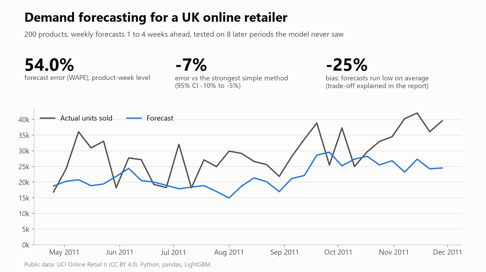
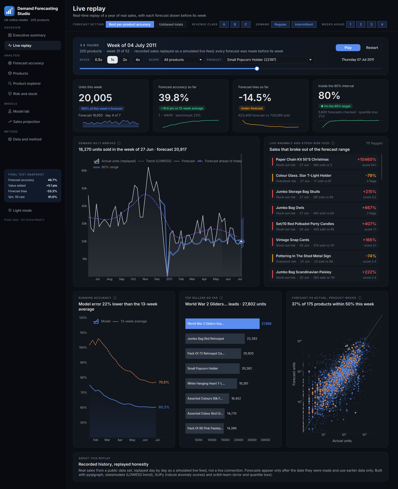
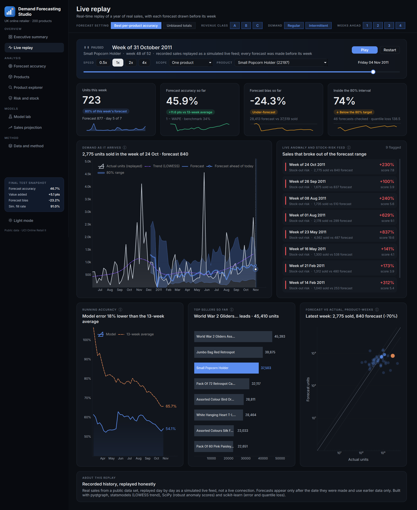
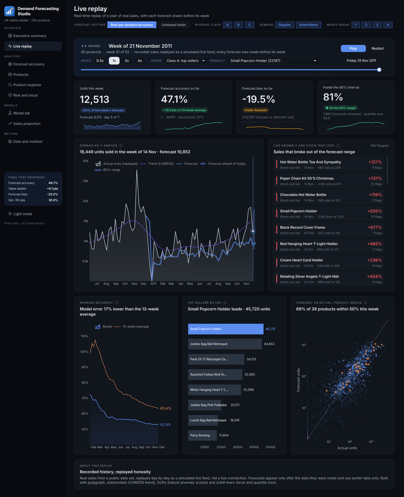
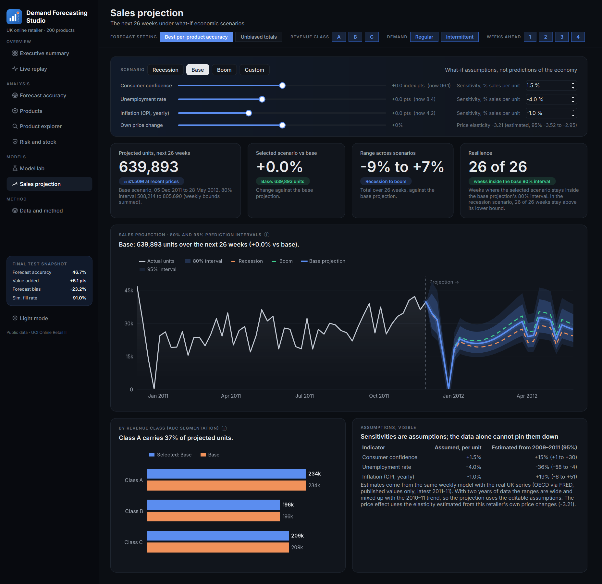

# Demand forecasting for a UK online retailer

Weekly unit forecasts, 1 to 4 weeks ahead, for the 200 highest-revenue products of a UK online gift retailer,
with an honest backtest against simple methods.

**Full write-up with all numbers and charts: [reports/REPORT.md](reports/REPORT.md)**



## What is in here

| Path | What it does |
|---|---|
| `src/prepare.py` | Cleans 1.07M raw transactions (cancellations, non-product codes, sheet overlap) into a weekly product panel |
| `src/features.py` | Builds model inputs that only use data available at forecast time |
| `src/backtest.py` | Rolling-origin backtest: 5 simple methods and LightGBM, 13 forecast dates |
| `src/evaluate.py` | WAPE, bias, bootstrap confidence intervals, segment breakdowns, interval calibration |
| `src/features_ext.py` | Feature engineering: intermittency (ADI, CV²), trend, Fourier seasonality, UK bank holidays, price and promotion proxies, product class and UK economic indicators, all known at the forecast date |
| `src/model_lab.py` | Statistical models (Holt damped trend, TSB / Croston, SARIMAX), XGBoost, HistGradientBoosting, LightGBM on the engineered features and an ensemble, on the same rolling backtest; SHAP importance |
| `src/macro.py` | Real UK economic indicators (OECD via FRED), cached in `data/external/` with sources, lagged to their publication date |
| `src/scenarios.py` | 26-week sales projection (SARIMAX) with 80% / 95% prediction intervals and what-if economic scenarios |
| `src/inventory.py` | Replenishment simulation: the same stock policy run with the forecast and with the benchmark |
| `src/report.py` | Charts and `reports/REPORT.md`, generated from the results |
| `app/desktop.py` | Demand Forecasting Studio, a PyQt6 desktop app: 9 pages (executive summary, live replay, accuracy, products, product explorer, risk and stock, model lab, sales projection, data and method), charts with a plain-language finding above each, a switch between the two forecast settings, filters, CSV export, dark mode by default (light mode one click away, the choice is remembered), a start-up screen and page fades. Screenshots in `reports/screens/` (dark; `_light` files show light mode) |
| `app/live.py` | The real-time Live replay page: animated pyqtgraph charts driven by a 30 fps timer (see below) |
| `app/dashboard.html` | The same view as a single HTML file (built by `src/build_dashboard.py`), no server needed |
| `tests/` | Tests that change the future and check the model inputs (including the engineered and economic features) do not move, plus checks of the inventory simulation and scenario maths |

## Live replay: real-time charts



The Live replay page plays one year of the retailer's real sales back as a simulated live feed. It is recorded
history, clearly labelled as such, not a live connection; every number is computed from the backtest output.

- **Demand as it arrives.** Sales fill in day by day from the cleaned transactions, so the current week grows as
  orders come in. A forecast appears only after the date it was made, so the forecast line and its 80% range always
  run ahead of "today". A LOWESS trend line (statsmodels) follows the sales seen so far.
- **Live KPIs that tick.** Units this week against the forecast, forecast accuracy so far (1 − WAPE) with the points
  added over the 13-week average, forecast bias so far with an under / over / unbiased tag, and the share of weeks
  inside the 80% interval. Each has a status pill and a sparkline. The running scores use
  scikit-learn metrics (mean absolute error, pinball / quantile loss).
- **Anomaly and stock-risk feed.** Product-weeks whose sales broke out of the 80% range by at least 2 robust
  standard deviations of that product's earlier misses (median absolute deviation, scipy), newest first, marked as
  stock-out or overstock risk.
- **Running accuracy, sales race and forecast-vs-actual scatter**, all animated as weeks are checked. The demand and
  accuracy charts end a few weeks after "today" and glide forward as each week completes. Hover over either chart
  for a crosshair and the values of that week.
- **Controls.** Play / pause, restart, speed 0.5x to 4x (at 1x a replayed week takes about 12 seconds, one day
  every 1.7 seconds), a timeline slider, and a scope picker: all products, a
  revenue class, regular or intermittent sellers, or one searchable product. The top-bar filters and the forecast
  setting apply too. Dark and light mode.
- **Performance.** pyqtgraph redraws only what changed; the ticking numbers are painted directly so they never
  force a relayout, which keeps the page at about 30 frames a second without blocking the window.

| | |
|---|---|
|  |  |

## Executive summary: the numbers planners use

The first page leads with **forecast accuracy (1 − WAPE, volume-weighted, units, weekly, 1–4 weeks ahead)**, the
**Forecast Value Added** in accuracy points over the 13-week average and over the same week last year, **forecast
bias** tagged under / over / unbiased against a ±5% target, and **A-item accuracy** (ABC segmentation). Every tile
states its grain: 200 products, rolling backtest, out-of-sample weeks only. Raw error tables (WAPE per segment,
error by horizon) stay on the Forecast accuracy page, where product-week error is explained as noisy for single
gift products.

**Inventory planning (simulated).** The same weekly order-up-to policy, with lost sales, runs once with the forecast
and once with the 13-week average, for all 200 products over the 32 final-test weeks.
Safety stock = z × σ × √(L + R), with σ from the last 13 weekly misses. Lead time (1–4 weeks), service target
(90/95/98%), unit cost (share of price) and holding rate are editable in the app. At a 1-week lead time, 95% target,
unit cost 45% of price and 25% holding rate:

| Same policy | Forecast | 13-week average |
|---|---|---|
| Simulated fill rate | 91.0% | 90.2% |
| Units short (32 weeks) | 84,016 | 91,657 |
| Weeks of cover | 2.2 | 2.3 |

At the benchmark's fill rate the forecast needs 11% less
stock: an estimated carrying-cost saving of about £2,333 a year (£1,400 to £3,266 at a 15–35%
holding rate) and about £29,587 a year of lost sales avoided at the same
service target. These are simulation results on recorded history with stated assumptions, not measured savings.

## Model lab: statistical models, machine learning and an ensemble

All models run on the same 13 forecast dates. The first 5 dates chose the ensemble members (the three models with
the lowest error there: LightGBM + engineered features, LightGBM (log target), LightGBM (L1));
the last 8 dates (6,400 product-weeks) are the out-of-sample test below.

| Model | Family | Accuracy (1 − WAPE) | Weekly-total accuracy | Bias | Error vs 13-week average (95% range) |
|---|---|---|---|---|---|
| Ensemble (top 3 on selection folds) | Ensemble | 46.7% | 73.4% | -23.2% | -8.7% (-11 to -7) |
| LightGBM (L1) | Machine learning | 46.4% | 74.9% | -20.7% | -8.2% (-10 to -6) |
| LightGBM + engineered features | Machine learning | 46.3% | 72.7% | -24.4% | -8.1% (-11 to -6) |
| LightGBM (log target) | Machine learning | 46.0% | 72.5% | -24.6% | -7.5% (-10 to -5) |
| XGBoost (Tweedie) | Machine learning | 43.3% | 81.9% | -3.4% | -2.9% (-6 to +0) |
| LightGBM (Tweedie) | Machine learning | 42.3% | 81.4% | -2.1% | -1.2% (-4 to +1) |
| 13-week average | Baseline | 41.6% | 80.7% | -8.8% | +0.0% (+0 to +0) |
| Exponential smoothing | Baseline | 41.4% | 82.0% | -2.4% | +0.5% (-3 to +4) |
| HistGradientBoosting (Poisson) | Machine learning | 40.9% | 82.7% | +1.6% | +1.2% (-2 to +4) |
| Holt damped trend (ETS) | Statistical | 40.7% | 81.3% | -1.3% | +1.5% (-2 to +5) |
| TSB / Croston (intermittent) | Statistical | 40.7% | 80.9% | -5.7% | +1.6% (+1 to +3) |
| 4-week average | Baseline | 40.3% | 79.8% | -5.2% | +2.3% (-1 to +5) |
| SARIMAX top-down | Statistical | 30.2% | 70.8% | +16.9% | +19.5% (+15 to +23) |
| Last week's sales | Baseline | 25.7% | 77.8% | +0.5% | +27.2% (+20 to +34) |
| Same week last year | Baseline | 10.9% | 67.3% | +28.5% | +52.6% (+41 to +64) |

The ensemble has the best per-product accuracy and is the default "Best per-product accuracy" setting; it
under-forecasts totals, so the "Unbiased totals" setting (LightGBM, Tweedie loss) stays available for total stock.
The SARIMAX model forecasts the weekly store total and splits it by each product's recent share, because single
products have too little history for a seasonal model. SHAP values come from LightGBM's built-in TreeSHAP.

**Feature engineering (49 features, from 27):** lags and recent sales,
rolling statistics, trend, intermittency (average gap between sales, CV², Syntetos–Boylan class), Fourier
seasonality, UK bank holidays and the Christmas peak, price against its 13- and 52-week levels, store-wide demand,
product class and UK economic indicators. Economic figures are used only from their publication date (month end +
45 days), and automated tests change the future (sales, prices and the economy) and check that no feature moves.

## Sales projection under different economic conditions



A SARIMAX model of weekly demand (Fourier seasonality, trading days, the Christmas shutdown) projects the next
26 weeks with 80% and 95% prediction intervals. What-if scenarios scale the projection by changes in
UK consumer confidence, unemployment and inflation, phased in over 13 weeks, plus an own-price
change:

| Scenario | Change in indicators | Units, next 26 weeks | vs base |
|---|---|---|---|
| Recession | confidence −3, unemployment +1.5 pts, inflation +1 pt | 583,690 | -8.8% |
| Base | none | 639,893 | – |
| Boom | confidence +2, unemployment −1 pt, inflation −1 pt | 682,662 | +6.7% |

The sensitivities are editable assumptions (confidence +1.5%, unemployment −4%, inflation −1% of sales per unit),
shown beside the effects estimated from the real 2009–2011 series (for example unemployment
-36% per point, 95% range -58% to
-4%). With two years of data those estimates are wide and mixed up with the trend,
so they are not used directly. The price elasticity (-3.21) is estimated from the
retailer's own price changes with product and week fixed effects. Scenarios are what-if assumptions, not predictions
of the economy.

## Design

The whole app follows one small design system, built from current guidance on analytics dashboards (Fluent 2 and
Microsoft data-visualisation guidance, WCAG 2.2 contrast rules, and the restrained style of tools such as Linear,
Stripe and Vercel):

- **Neutral surfaces, colour for meaning.** Blue is always the model and the selected state, orange the simple
  method, grey the actual sales; green, red and amber are kept for good, bad and warning.
- **Two matched themes.** Light and dark use the same hues; dark mode uses layered near-black surfaces (no pure
  black) and slightly lighter, less saturated colours so nothing glows.
- **One typeface.** Inter (bundled in `app/fonts`, SIL Open Font License) with hierarchy from size and weight.
- **Quiet charts.** Thin, light gridlines, no chart borders, values labelled directly, gradient fills that fade to
  the baseline, a single highlight per chart.
- **Big numbers first.** Eye-tracking work on dashboards (Tableau Research) finds that large numbers draw the first
  and longest look, so each headline number is large and carries a coloured status pill (arrow and comparison)
  instead of a sentence. Headline accuracy is shown with its grain and the points added over the benchmark;
  the full error tables stay on the accuracy and model pages.
- **Dark first.** The app opens in dark mode; colour and a soft glow are kept for live elements (the forecast line,
  today's point) so the eye goes there first.
- **Less text on screen.** Every card states one finding; the "how to read it" note sits behind the (i) icon.
- **Cards and spacing.** Rounded 14 px cards with hairline borders instead of heavy shadows, an 8 / 16 / 24 px
  spacing rhythm, a sidebar with line icons, grouped sections and a final-test snapshot.

## Tech stack

| Area | Libraries |
|---|---|
| Data preparation | pandas, NumPy, PyArrow (Parquet), openpyxl |
| Forecasting | LightGBM, XGBoost, scikit-learn HistGradientBoosting, statsmodels (Holt damped trend, SARIMAX), TSB / Croston, an ensemble, five baseline methods |
| Statistics | statsmodels (LOWESS trend, scenario regressions), SciPy (robust anomaly scores, service-level z), scikit-learn (error and quantile-loss metrics), TreeSHAP |
| Inventory | Replenishment simulation (order-up-to, lost sales, safety stock from forecast misses) |
| Desktop app | PyQt6, pyqtgraph (real-time charts), Matplotlib (static charts), Inter typeface |
| Testing | pytest (leakage tests, simulation and scenario checks) |

## How the test is kept honest

- Products are selected from the first year only.
- The model setting and the reference baseline are chosen on the first 5 forecast dates. The last 8 are the final
  test and are not used for any choice.
- The gain over the baseline is reported with a 95% confidence interval.
- Weak spots are reported, including a forecast bias and the segments where the gain is small.

## Run it

```
pip install -r requirements.txt
python run_all.py            # download, clean, backtest, model lab, scenarios, inventory, report (about 12 minutes)
python -m pytest tests -q
python app/desktop.py
python app/desktop.py --screenshot reports/screens   # regenerate the screenshots
```

## Data

UCI Machine Learning Repository, "Online Retail II" (Chen, 2019), licence CC BY 4.0.
https://archive.ics.uci.edu/dataset/502/online+retail+ii
The raw file is downloaded by `run_all.py` and is not stored in this repository.

UK economic indicators: OECD Main Economic Indicators via FRED (Federal Reserve Bank of St. Louis), cached in
`data/external/uk_macro_monthly.csv`; UK bank holidays from gov.uk. Sources in `data/external/SOURCES.md`.
