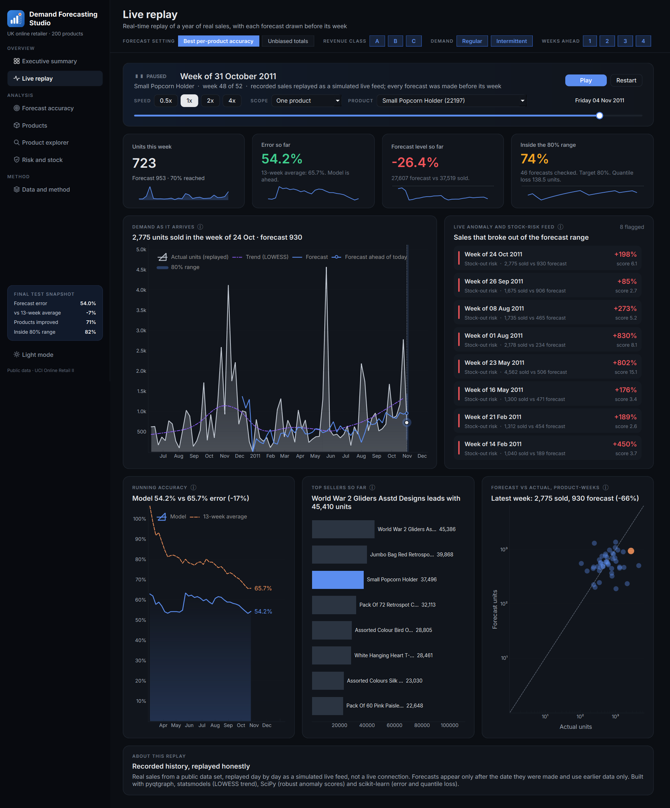
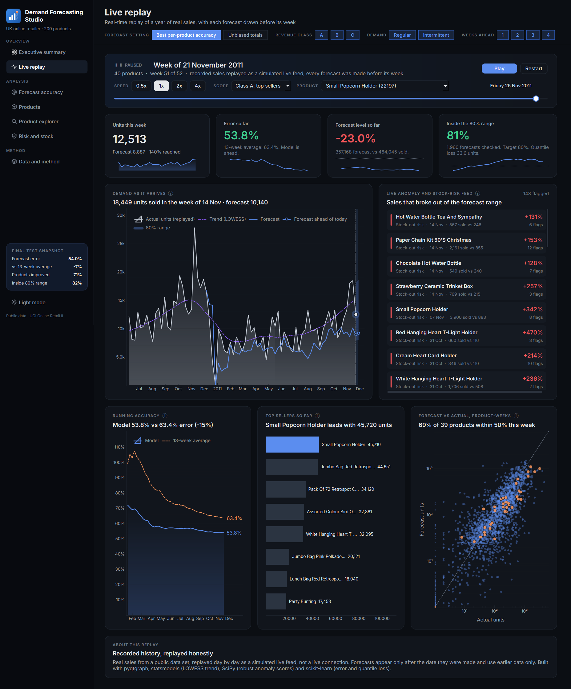

# Demand forecasting for a UK online retailer

Weekly unit forecasts, 1 to 4 weeks ahead, for the 200 highest-revenue products of a UK online gift retailer,
with an honest backtest against simple methods.

**Full write-up with all numbers and charts: [reports/REPORT.md](reports/REPORT.md)**


## What is in here

| Path | What it does |
|---|---|
| `src/prepare.py` | Cleans 1.07M raw transactions (cancellations, non-product codes, sheet overlap) into a weekly product panel |
| `src/features.py` | Builds model inputs that only use data available at forecast time |
| `src/backtest.py` | Rolling-origin backtest: 5 simple methods and LightGBM, 13 forecast dates |
| `src/evaluate.py` | WAPE, bias, bootstrap confidence intervals, segment breakdowns, interval calibration |
| `src/report.py` | Charts and `reports/REPORT.md`, generated from the results |
| `app/desktop.py` | Demand Forecasting Studio, a PyQt6 desktop app: 7 pages (executive summary, live replay, accuracy, products, product explorer, risk and stock, data and method), charts with a plain-language finding above each, a switch between the two forecast settings, filters, CSV export, dark mode. Screenshots in `reports/screens/` |
| `app/live.py` | The real-time Live replay page: animated pyqtgraph charts driven by a 30 fps timer (see below) |
| `app/dashboard.html` | The same view as a single HTML file (built by `src/build_dashboard.py`), no server needed |
| `tests/` | Tests that change the future and check the model inputs do not move |

## Live replay: real-time charts


The Live replay page plays one year of the retailer's real sales back as a simulated live feed. It is recorded
history, clearly labelled as such, not a live connection; every number is computed from the backtest output.

- **Demand as it arrives.** Sales fill in day by day from the cleaned transactions, so the current week grows as
  orders come in. A forecast appears only after the date it was made, so the forecast line and its 80% range always
  run ahead of "today". A LOWESS trend line (statsmodels) follows the sales seen so far.
- **Live KPIs that tick.** Units this week against the forecast, running error (WAPE) against the 13-week average,
  forecast level (bias) and the share of weeks inside the 80% range, each with a sparkline. The running scores use
  scikit-learn metrics (mean absolute error, pinball / quantile loss).
- **Anomaly and stock-risk feed.** Product-weeks whose sales broke out of the 80% range by at least 2 robust
  standard deviations of that product's earlier misses (median absolute deviation, scipy), newest first, marked as
  stock-out or overstock risk.
- **Running accuracy, sales race and forecast-vs-actual scatter**, all animated as weeks are checked.
- **Controls.** Play / pause, restart, speed 0.5x to 4x (at 1x a replayed week takes about 12 seconds, one day
  every 1.7 seconds), a timeline slider, and a scope picker: all products, a
  revenue class, regular or intermittent sellers, or one searchable product. The top-bar filters and the forecast
  setting apply too. Light and dark mode.
- **Performance.** pyqtgraph redraws only what changed; the ticking numbers are painted directly so they never
  force a relayout, which keeps the page at about 30 frames a second without blocking the window.

| | |
|---|---|
|  |  |

## Design

The whole app follows one small design system, built from current guidance on analytics dashboards (Fluent 2 and
Microsoft data-visualisation guidance, WCAG 2.2 contrast rules, and the restrained style of tools such as Linear,
Stripe and Vercel):

- **Neutral surfaces, colour for meaning.** Blue is always the model and the selected state, orange the simple
  method, grey the actual sales; green, red and amber are kept for good, bad and warning.
- **Two matched themes.** Light and dark use the same hues; dark mode uses layered near-black surfaces (no pure
  black) and slightly lighter, less saturated colours so nothing glows.
- **One typeface.** Inter (bundled in `app/fonts`, SIL Open Font License) with hierarchy from size and weight.
- **Quiet charts.** Thin, light gridlines, no chart borders, values labelled directly, gradient fills that fade to
  the baseline, a single highlight per chart.
- **Less text on screen.** Every card states one finding; the "how to read it" note sits behind the (i) icon.
- **Cards and spacing.** Rounded 14 px cards with hairline borders instead of heavy shadows, an 8 / 16 / 24 px
  spacing rhythm, a sidebar with line icons, grouped sections and a final-test snapshot.

## Tech stack

| Area | Libraries |
|---|---|
| Data preparation | pandas, NumPy, PyArrow (Parquet), openpyxl |
| Forecasting | LightGBM (gradient boosting), five baseline methods |
| Statistics | statsmodels (LOWESS trend), SciPy (robust anomaly scores), scikit-learn (error and quantile-loss metrics) |
| Desktop app | PyQt6, pyqtgraph (real-time charts), Matplotlib (static charts), Inter typeface |
| Testing | pytest (leakage tests) |

## How the test is kept honest

- Products are selected from the first year only.
- The model setting and the reference baseline are chosen on the first 5 forecast dates. The last 8 are the final
  test and are not used for any choice.
- The gain over the baseline is reported with a 95% confidence interval.
- Weak spots are reported, including a forecast bias and the segments where the gain is small.

## Run it

```
pip install -r requirements.txt
python run_all.py            # download, clean, backtest, score, report (about 10 minutes)
python -m pytest tests -q
python app/desktop.py
python app/desktop.py --screenshot reports/screens   # regenerate the screenshots
```

## Data

UCI Machine Learning Repository, "Online Retail II" (Chen, 2019), licence CC BY 4.0.
https://archive.ics.uci.edu/dataset/502/online+retail+ii
The raw file is downloaded by `run_all.py` and is not stored in this repository.
