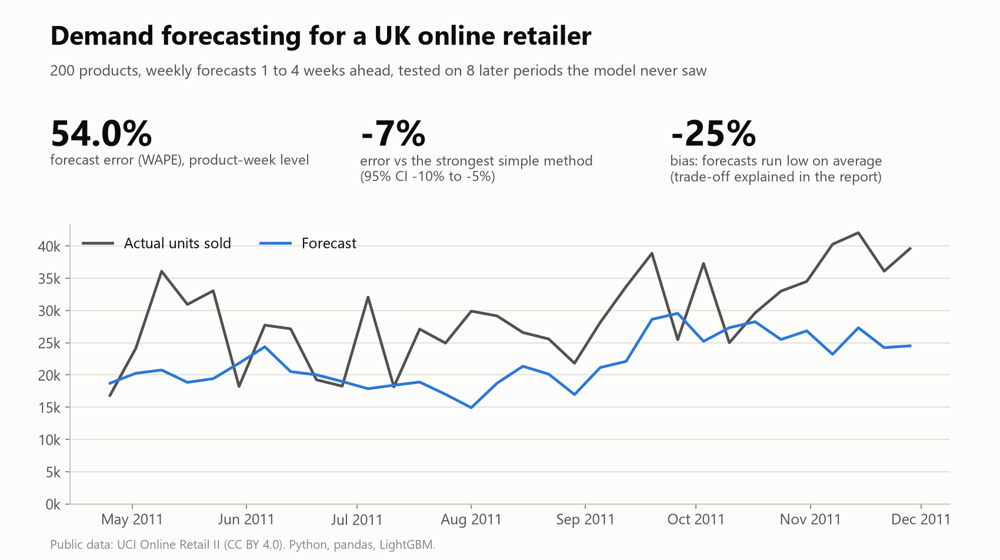
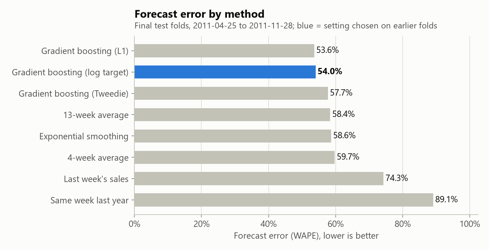
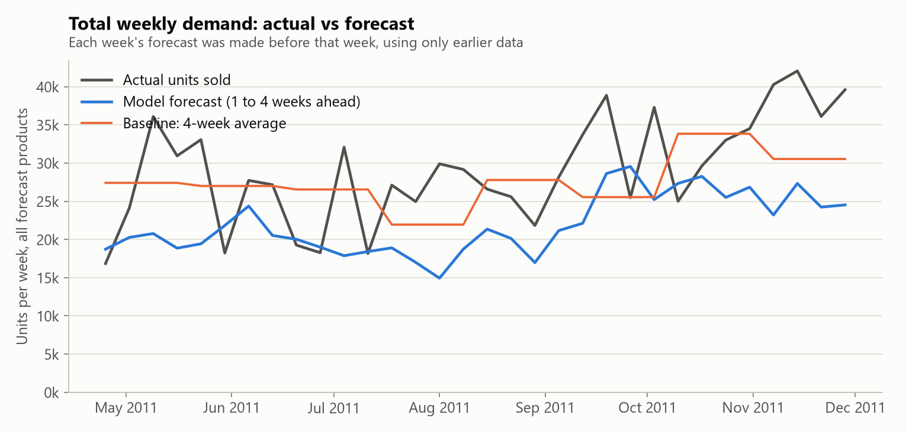
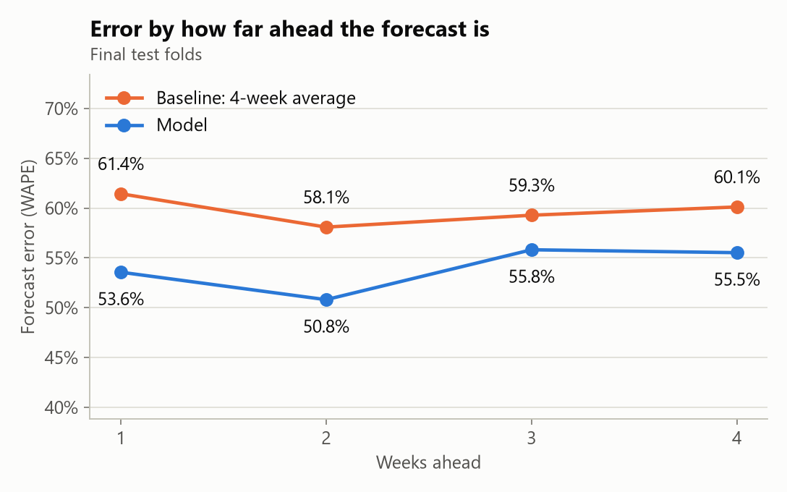
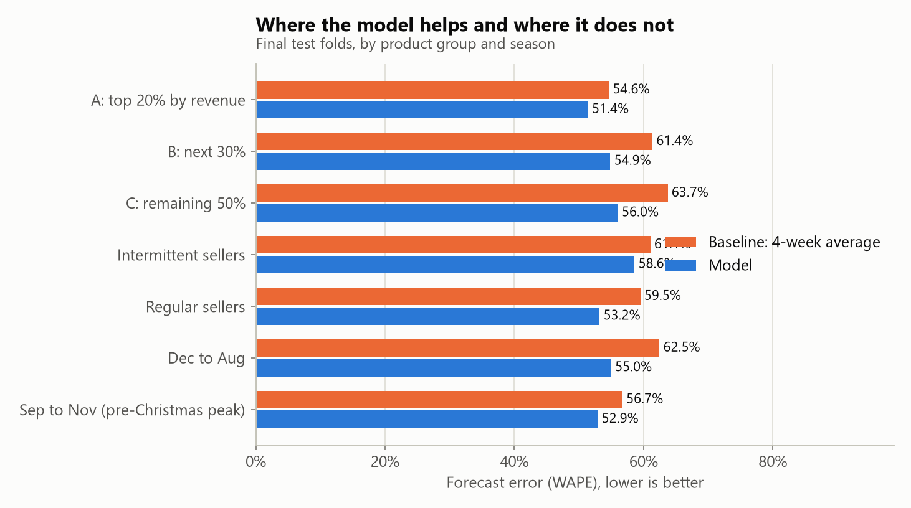
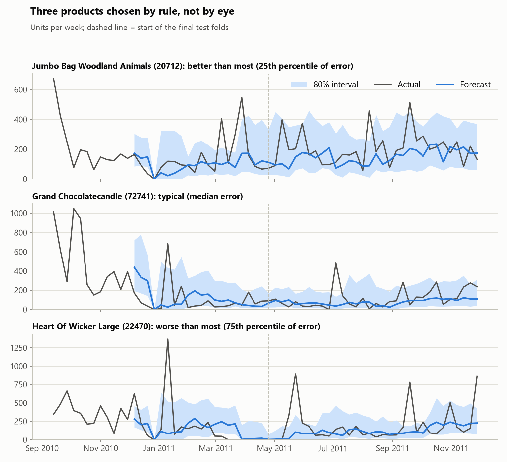
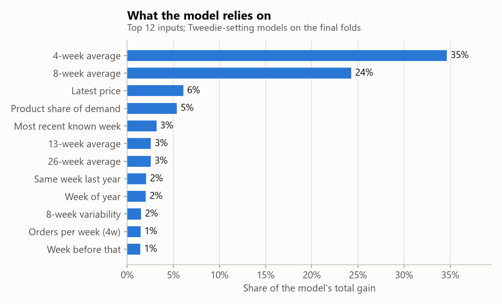
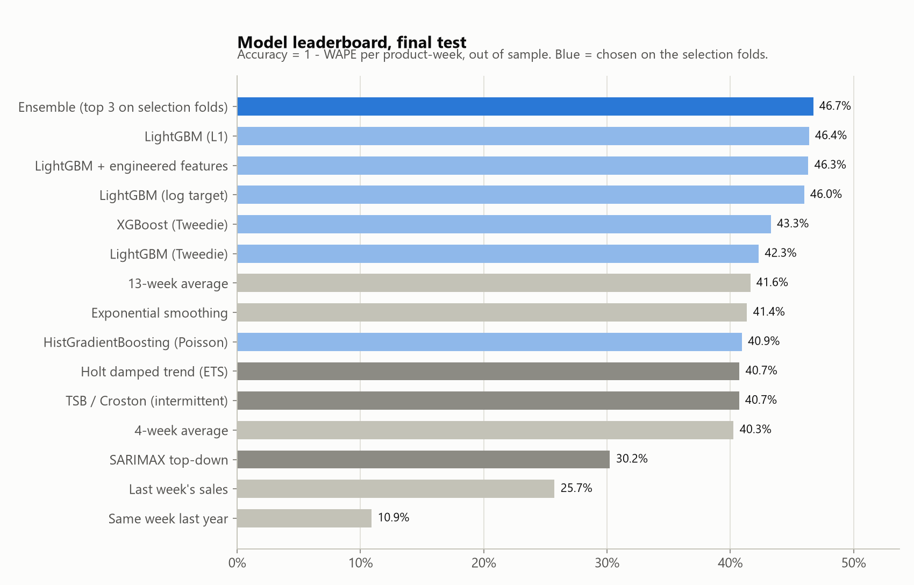
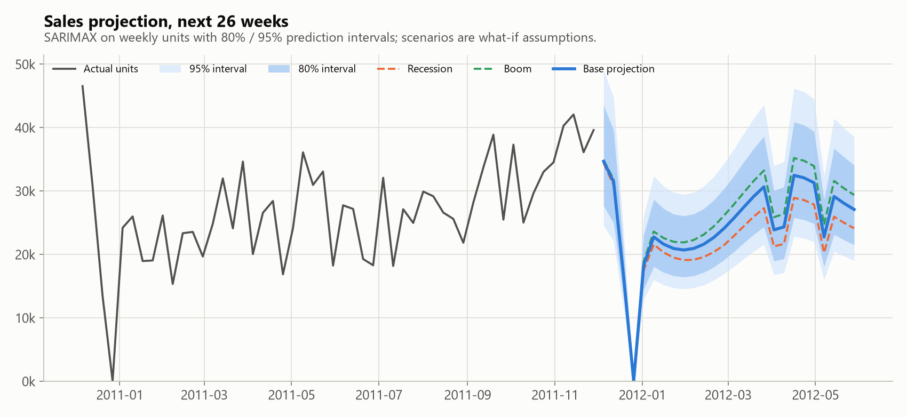

# Demand forecasting for a UK online retailer

Weekly unit forecasts, 1 to 4 weeks ahead, for the 200 highest-revenue products of a UK online
gift retailer. Public data, fully reproducible. Every number below is generated by the code in this repository.



## Result in short (as shown in the app)

Final test, 25 Apr 2011 to 28 Nov 2011: 6,400 out-of-sample product-week
forecasts for 200 products, 1 to 4 weeks ahead. Benchmark: 13-week average. "Level" means the 95% range
of the difference includes zero.

| Setting | Weekly-total accuracy | Value added, weekly total | Forecast bias | Product-level accuracy | Value added, per product |
|---|---|---|---|---|---|
| Unbiased totals (default) | 81.4% | +0.7 pts (level, 95% range -4.0 pts to +5.1 pts) | -2.1% | 42.3% | +0.7 pts (level, 95% range -0.8 pts to +2.1 pts) |
| Best per-product accuracy | 73.4% | -7.4 pts (below, 95% range -11.9 pts to -2.3 pts) | -23.2% | 46.7% | +5.1 pts (better, 95% range +3.7 pts to +6.8 pts) |
| 13-week average (benchmark) | 80.7% | - | -8.8% | 41.6% | - |

The app opens on "Unbiased totals": its weekly totals are level with the benchmark
(+0.7 pts) and its forecast level is -2.1% against -8.8% for the
benchmark. The other setting is closer product by product and low on totals by design. Accuracy = 1 - WAPE; weekly
totals add all products up before comparing.


## First model in detail (Gradient boosting (log target))

The rest of this section and the next ones describe the first model of the project, before the model lab added
more models and the app switched to the two settings above.

- On the final test folds (2011-04-25 to 2011-11-28, 6,400 product-week
  forecasts) the chosen model has a forecast error (WAPE) of **54.0%**. The reference simple method,
  4-week average (the best one on the selection folds), has 59.7%.
- The model's error is 10% lower than the reference simple method (95% confidence interval: 7% to 12% lower).
- Against the strongest simple method on the final folds, 13-week average (58.4%), the model's error is -7% (95% CI -10% to -5%). This is the tougher comparison.
- On total weekly demand across all products the model's error is 27.5%.
- The model beats the baseline on 77% of products.
- The 80% prediction interval contained the actual value 82% of the time.
- Model bias is -24.6% of actual units (negative means it forecasts too low on average). See
  "The trade-off" below; this matters for stock planning.

WAPE is total absolute error divided by total actual units. A WAPE of 40% means the forecasts were off by 40 units
for every 100 sold. Product-week demand for gift items is noisy, so errors at this level are large for every method;
the comparison with simple methods is what matters.

## Data

Source: UCI Machine Learning Repository, "Online Retail II" (licence CC BY 4.0). All transactions of a UK online
retailer between 2009-12-01 and 2011-12-09.

| Cleaning step | Rows |
|---|---|
| Raw transaction rows | 1,067,371 |
| Removed: duplicate period shared by the two source sheets | 22,523 |
| Cancellation rows | 19,165 |
| Cancellations matched to their original sale (sale removed too) | 6,430 |
| Removed: zero or negative quantity or price | 6,027 |
| Removed: non-product codes (postage, fees, adjustments) | 4,537 |
| Clean rows kept | 1,008,689 |

Cancelled sales matter: 407,272 units were sold and then cancelled. Leaving them in
would count orders that never shipped as demand.

The data was grouped into 104 full weeks (2009-12-07 to 2011-11-28). The business was shut in
2 of them (Christmas and New Year); those weeks are forecast as zero by every method and are
not scored.

Products: 200 were selected out of 4,668, using the first 52 weeks only
(sold in at least 26 of those weeks, then ranked by revenue). They made up
42% of first-year revenue. Choosing them from the first year alone
means no information from the test period decided which products are in the study. 8% of
product-weeks have zero sales.

## Method

**Test design.** A rolling-origin backtest: the forecast date moves forward 4 weeks at a time, and at each date
the methods see only earlier data and forecast the next 4 weeks. There are 13 forecast dates.
The first 5 were used to choose the model setting and the reference baseline. The last
8 are the final test and were not used for any choice.

**Simple methods.** Last week's sales; 4-week average; 13-week average; same week last year; exponential smoothing
with the smoothing factor tuned per product.

**Model.** One gradient-boosting model (LightGBM) trained across all products, with a separate model for each of the
4 horizons. Inputs: recent sales and averages, variability, weeks since the last sale, same week last year, price and
price change, demand across all products, product age, and the calendar of the target week (week of year, weeks to
Christmas, trading days). For a forecast h weeks ahead, the newest sales figure used is h weeks old; automated tests
in `tests/` change the future and confirm the inputs do not move. Three loss settings were tried; the one with the
lowest error on the selection folds was kept (Gradient boosting (log target)).

**Prediction intervals.** Two quantile models give a 10% and 90% forecast. The interval is then adjusted using the
errors from earlier folds only (conformal calibration), so the adjustment never sees the fold it is applied to.

**Trading days.** The number of trading days in the target week is used as an input. It is taken from the data, on
the assumption that a planner knows the shutdown calendar in advance.

## Results on the final test folds

| Method | WAPE | Bias | WAPE on weekly total |
|---|---|---|---|
| Gradient boosting (L1) | 53.6% | -20.7% | 25.1% |
| Gradient boosting (log target) (chosen) | 54.0% | -24.6% | 27.5% |
| Gradient boosting (Tweedie) | 57.7% | -2.1% | 18.6% |
| 13-week average | 58.4% | -8.8% | 19.3% |
| Exponential smoothing | 58.6% | -2.4% | 18.0% |
| 4-week average | 59.7% | -5.2% | 20.2% |
| Last week's sales | 74.3% | +0.5% | 22.2% |
| Same week last year | 89.1% | +28.5% | 32.7% |



Difference between the model and 4-week average (the best simple method on the selection folds):
-5.7 WAPE points, 95% CI -7.5 to -3.9. The interval comes
from 2,000 bootstrap resamples of whole products. The model was better in
100% of resamples.

On the final folds a different simple method, 13-week average, turned out to be the strongest baseline. Against that one the model's error is -7% (95% CI -10% to -5%).

The other two loss settings are listed in the table for transparency; they were not chosen and their final-fold
scores played no part in the choice.

### The trade-off: lower error per product, but forecasts that run low

The chosen setting was picked for the lowest WAPE on the selection folds, and that rule has a cost. Minimising absolute error pulls a forecast toward the median, and for skewed demand the median is below the average. The chosen model therefore forecasts 25% fewer units than were actually sold, and its error on total weekly demand (27.5%) is worse than the best simple method's (18.0%).

The Tweedie setting aims at the average instead. Its bias is -2.1% and its error on total weekly demand is 18.6%, but its product-level WAPE is 57.7%, only slightly better than the simple averages.

What this means in practice: use the chosen setting when the question is 'what will a typical week look like for this product', and the Tweedie setting (or the upper interval bound) when the question is 'how much stock do we need in total'. Neither setting is good at both on this data. No setting was changed after the final folds were scored; the three loss settings above are the only ones that were run.



### By horizon

| Weeks ahead | Model WAPE | Baseline WAPE | Change | Model bias |
|---|---|---|---|---|
| 1 | 53.6% | 61.4% | -13% | -22.9% |
| 2 | 50.8% | 58.1% | -13% | -17.7% |
| 3 | 55.8% | 59.3% | -6% | -28.1% |
| 4 | 55.5% | 60.1% | -8% | -28.9% |



### By product group and season

| Revenue class | Model WAPE | Baseline WAPE | Change | Model bias |
|---|---|---|---|---|
| A | 51.4% | 54.6% | -6% | -28.5% |
| B | 54.9% | 61.4% | -11% | -25.9% |
| C | 56.0% | 63.7% | -12% | -19.0% |

| Demand pattern | Model WAPE | Baseline WAPE | Change | Model bias |
|---|---|---|---|---|
| intermittent | 58.6% | 61.1% | -4% | -34.2% |
| regular | 53.2% | 59.5% | -11% | -22.9% |

| Season | Model WAPE | Baseline WAPE | Change | Model bias |
|---|---|---|---|---|
| Dec-Aug | 55.0% | 62.5% | -12% | -24.4% |
| Sep-Nov peak | 52.9% | 56.7% | -7% | -24.7% |



Revenue class and demand pattern were assigned from the first year only. "Intermittent" means the product had no
sales in more than 20% of first-year weeks.

### Prediction intervals

| | Coverage of the 80% interval | Average width (relative to recent demand) |
|---|---|---|
| Raw quantile models | 73.2% | 3.72 |
| After calibration on earlier folds | 82.4% | 3.86 |

Calibrated coverage by horizon: 1 wk: 83%, 2 wk: 83%, 3 wk: 82%, 4 wk: 81%. Actual demand was at or below the upper bound in
89.3% of product-weeks; that upper bound is the natural starting point for a
stock level.

### Example products



The three products are the ones at the 25th, 50th and 75th percentile of model error among class A and B products
(20712, 72741, 22470), so the chart shows a good, a typical and a poor case instead of hand-picked ones.

### What the model relies on



Importance was recorded for the Tweedie-setting models. Recent averages carry most of the signal, which is why the
simple averages are hard to beat on this data.

## Model lab: more models on the same backtest



Statistical models (Holt damped trend, TSB / Croston for intermittent demand, SARIMAX on the weekly total split by
product share), XGBoost, scikit-learn HistGradientBoosting, LightGBM on 49 engineered features and
an ensemble were added and run on the same 13 forecast dates. The ensemble members were chosen on the 5 selection
dates (LightGBM + engineered features, LightGBM (log target), LightGBM (L1)); the table is the final test
(6,400 product-weeks).

| Model | Family | Accuracy (1 - WAPE) | Weekly-total accuracy | Bias | A-item accuracy | Error vs 13-week average (95% range) |
|---|---|---|---|---|---|---|
| Ensemble (top 3 on selection folds) | Ensemble | 46.7% | 73.4% | -23.2% | 49.8% | -8.7% (-11 to -7) |
| LightGBM (L1) | Machine learning | 46.4% | 74.9% | -20.7% | 49.8% | -8.2% (-10 to -6) |
| LightGBM + engineered features | Machine learning | 46.3% | 72.7% | -24.4% | 49.6% | -8.1% (-11 to -6) |
| LightGBM (log target) | Machine learning | 46.0% | 72.5% | -24.6% | 48.6% | -7.5% (-10 to -5) |
| XGBoost (Tweedie) | Machine learning | 43.3% | 81.9% | -3.4% | 48.7% | -2.9% (-6 to +0) |
| LightGBM (Tweedie) | Machine learning | 42.3% | 81.4% | -2.1% | 48.2% | -1.2% (-4 to +1) |
| 13-week average | Baseline | 41.6% | 80.7% | -8.8% | 46.1% | +0.0% (+0 to +0) |
| Exponential smoothing | Baseline | 41.4% | 82.0% | -2.4% | 47.4% | +0.5% (-3 to +4) |
| HistGradientBoosting (Poisson) | Machine learning | 40.9% | 82.7% | +1.6% | 46.7% | +1.2% (-2 to +4) |
| Holt damped trend (ETS) | Statistical | 40.7% | 81.3% | -1.3% | 48.1% | +1.5% (-2 to +5) |
| TSB / Croston (intermittent) | Statistical | 40.7% | 80.9% | -5.7% | 45.0% | +1.6% (+1 to +3) |
| 4-week average | Baseline | 40.3% | 79.8% | -5.2% | 45.4% | +2.3% (-1 to +5) |
| SARIMAX top-down | Statistical | 30.2% | 70.8% | +16.9% | 36.8% | +19.5% (+15 to +23) |
| Last week's sales | Baseline | 25.7% | 77.8% | +0.5% | 33.1% | +27.2% (+20 to +34) |
| Same week last year | Baseline | 10.9% | 67.3% | +28.5% | 25.4% | +52.6% (+41 to +64) |

**Ensemble (top 3 on selection folds)** is chosen on the selection dates and has the best final-test accuracy, 46.7%:
+5.1 accuracy points over the 13-week average (Forecast Value Added). It under-forecasts totals
(-23.2%), so the Tweedie setting stays the choice for total stock. Engineered features include
intermittency (ADI, CV²), trend, Fourier seasonality, UK bank holidays, price against its 13- and 52-week levels,
product class and UK economic indicators taken at their publication date; leakage tests cover all of them.

## Inventory planning: replenishment simulation

The same weekly order-up-to policy with lost sales runs once with each forecast setting and once with the
13-week average, for 200 products over the 32 final-test weeks
(2011-04-25 to 2011-11-28). Safety stock = z x sigma x sqrt(L + R), sigma from the last 13 weekly
misses. Lead time 1 week, review 1 week, 95% target (z = 1.64), unit cost
45% of price, holding rate 25% a year; all four are editable in the app.

| Same policy | Unbiased totals | Best per-product accuracy | 13-week average |
|---|---|---|---|
| Simulated fill rate | 91.5% | 91.0% | 90.2% |
| Units short (32 weeks) | 79,422 | 84,016 | 91,657 |
| Weeks of cover | 2.5 | 2.2 | 2.3 |
| Stock needed for the benchmark's fill rate | -2.4% | -11.3% | - |
| Carrying-cost saving a year (15-35% holding rate) | about GBP 493 (GBP 296 to 690) | about GBP 2,333 (GBP 1,400 to 3,266) | - |
| Lost sales avoided a year, same service target | about GBP 59,000 | about GBP 29,587 | - |

"Stock needed" compares average stock when the forecast is tuned to the benchmark's fill rate. Simulation on
recorded history with stated assumptions, not measured savings.

## Sales projection under economic scenarios



A SARIMAX model of weekly units (Fourier seasonality, trading days, the Christmas shutdown) projects the next
26 weeks with 80% and 95% prediction intervals. Scenarios change UK consumer confidence,
unemployment and inflation (phased in over 13 weeks):

| Scenario | Units, next 26 weeks | vs base |
|---|---|---|
| Recession (confidence -3, unemployment +1.5 pts, inflation +1 pt) | 583,690 | -8.8% |
| Base | 639,893 | - |
| Boom (confidence +2, unemployment -1 pt, inflation -1 pt) | 682,662 | +6.7% |

Sensitivities are stated assumptions (confidence +1.5%, unemployment -4%, inflation -1% of sales per unit). The
effects estimated from the real 2009-2011 series are wide (unemployment -36% per
point, 95% range -58% to -4%) and mixed up with
the trend, so they are shown but not used. Own-price elasticity, estimated with product and week fixed effects:
-3.21. Economic data: OECD via FRED, see `data/external/SOURCES.md`.

## Limits

- Two years of data. Only one earlier Christmas season is available for training, so the pre-Christmas peak is the
  hardest period and "same week last year" has a single year behind it.
- Sales are not the same as demand: weeks with no stock look like weeks with no demand. The data has no stock levels.
- No promotion calendar is available. Price changes are visible only after they happen.
- The 200 products are the established top sellers. New and slow products are harder and are not covered.
- One retailer, one period. The size of the gain will differ on other data.
- The model was run once with fixed settings. Likely improvements that were NOT tried: scaling each product's sales
  by its own level before training, a promotion or price-plan input, and hierarchical reconciliation so product
  forecasts add up to an unbiased total.

## Reproduce

```
pip install -r requirements.txt
python run_all.py            # download, clean, backtest, model lab, scenarios, inventory, report (about 12 minutes)
python -m pytest tests -q    # leakage, simulation and scenario tests
python app/desktop.py          # PyQt6 desktop app
python -m src.build_dashboard  # single-file HTML dashboard: app/dashboard.html
```
